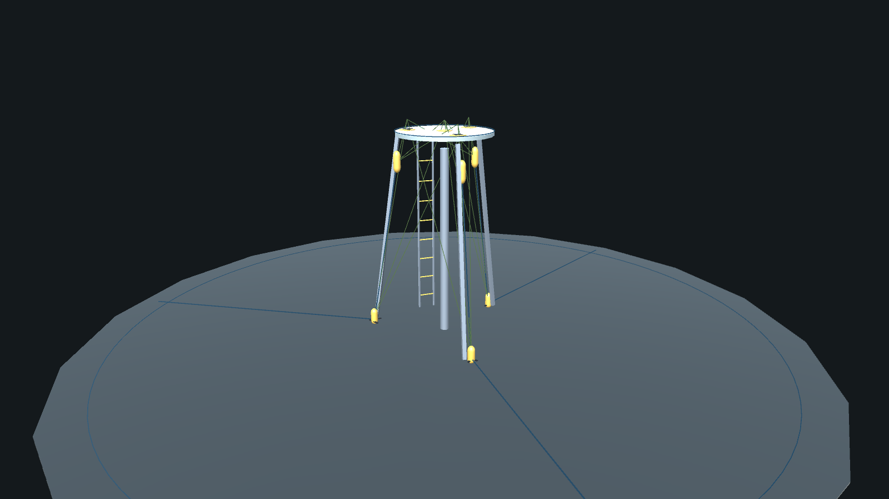
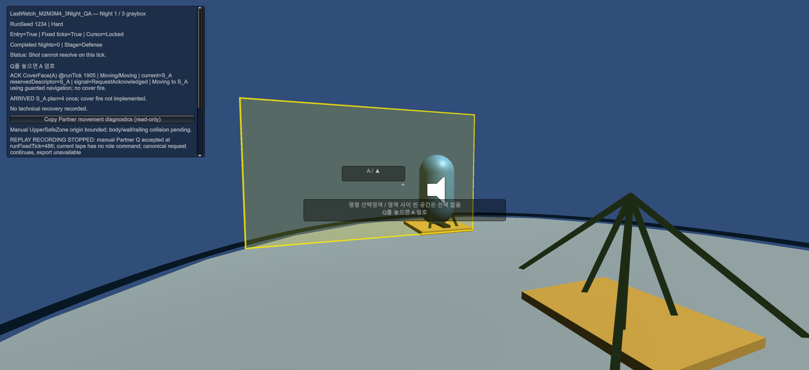

# Last Watch

**개발 중 · Graybox Prototype · 개인 개발 포트폴리오**

감시탑을 거점으로 적의 공세에 맞서며, 플레이어와 파트너의 생존을 다루는 싱글플레이 1인칭 생존 디펜스 FPS 프로토타입입니다.

현재는 기본 도형과 임시 표현으로 공간, 전투, 파트너 상호작용을 개발하는 **그레이박스 단계**입니다. 최종 아트·애니메이션·사운드·UI를 갖춘 완성품이 아니며, 기능과 조작은 개발 과정에서 변경될 수 있습니다.



*초기 M2 공간 구조 검토용 Unity 캡처입니다. 최신 플레이 화면이나 최종 비주얼을 나타내지 않습니다. 노란 캡슐과 선은 개발용 구조 표시입니다.*



*1인칭 시점에서 파트너의 엄호 구역을 지정하는 모습. 개발 중인 그레이박스 화면이며 진단 UI와 임시 시각 표현이 포함되어 있습니다.*

## 공개 범위

- Unity 런타임 소스: 전투·적·파트너·이동·상태 저장 관련 코드
- 그레이박스 QA 씬과 개발·검증용 Editor 코드
- Edit Mode / Play Mode 테스트 소스와 입력 계획
- Unity 패키지 목록과 프로젝트 설정

공개본은 개발 중인 소스 스냅샷입니다. 이 공개 준비 과정에서 Unity 실행·컴파일·게임플레이 검증은 수행하지 않았습니다. 테스트 코드의 포함은 테스트 통과를 의미하지 않으며, 빌드나 WebGL 플레이 버전은 제공하지 않습니다.

## Unity에서 열기

1. Unity Hub에서 **Unity 6000.0.58f2**를 준비합니다.
2. 저장소의 `LastWatch/` 폴더를 Unity 프로젝트로 추가합니다.
3. 패키지 복원과 임포트가 끝나면 `Assets/Scenes/LastWatch_M2M3M4_3Night_QA.unity`를 엽니다.
4. 프로토타입을 직접 확인할 때 Play Mode에 진입합니다. 시작 화면에서는 `Enter`로 진행합니다.

현재 Build Settings의 씬 목록은 비어 있습니다. 위 경로는 Editor에서 QA 씬을 여는 안내이며 빌드 재현을 보증하지 않습니다. 일부 증거 수집 메뉴는 내부 검증 자료와 별도 실행 환경이 필요하므로, 공개본만으로 전체 QA 절차가 재현되지는 않습니다.

## 기본 조작

현재 컨트롤러 소스를 기준으로 정리한 조작입니다.

| 입력 | 동작 |
| --- | --- |
| WASD / 마우스 | 이동 / 시점 |
| 왼쪽 Shift | 빠른 이동 |
| 마우스 왼쪽 / 오른쪽 | 사격 / 조준 |
| R | 재장전 |
| 1 / 2 / 3 | 무기 선택 |
| Q | 파트너 상호작용 |
| Esc | 상황에 따라 일시 정지 또는 커서 해제 |

## 저장소 구성

```text
LastWatch/
  Assets/           # 소스, 셰이더, QA 씬, Editor 도구, 테스트
  Packages/         # manifest.json, packages-lock.json
  ProjectSettings/  # Unity 버전과 프로젝트 설정
tests/LastWatch/input-plans/
docs/images/
```

Unity 캐시·로그·로컬 세이브·개인 설정·내부 기획/인계/검증 기록·다른 프로젝트·과거 Git 이력은 포함하지 않습니다. 이 공개본을 준비하며 게임 버전을 올리지 않았습니다.

## 이용 안내

별도의 오픈소스 라이선스는 부여하지 않았습니다. 코드와 이미지의 재사용·재배포가 필요한 경우 저장소 소유자에게 문의해 주세요. Unity 및 Unity 패키지에는 해당 제공자의 이용 조건이 적용됩니다.
